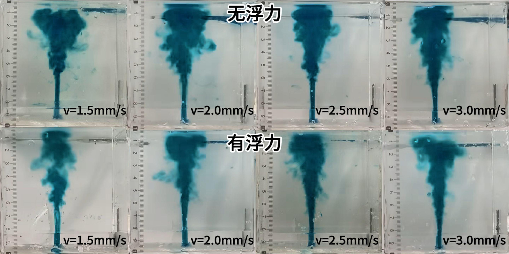
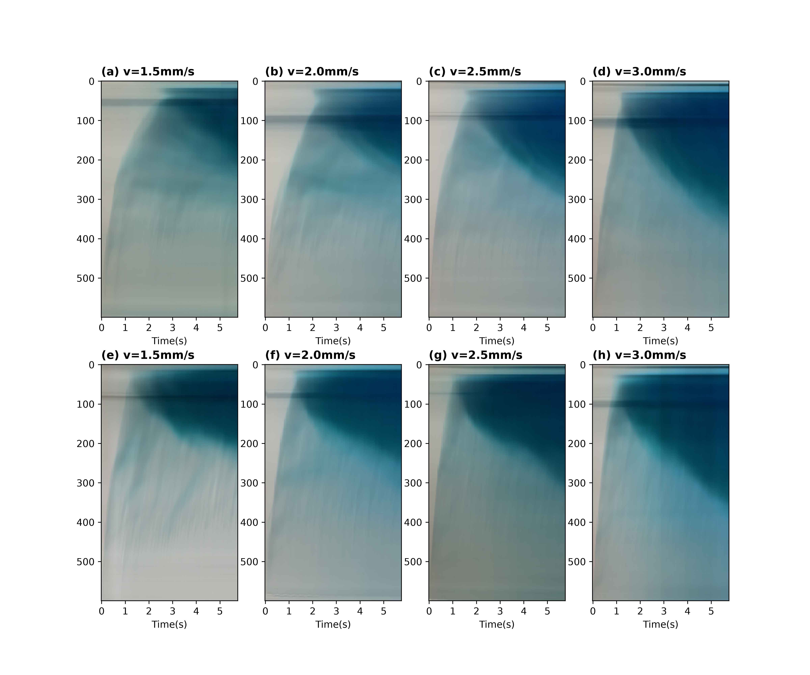

# 南京大学夹卷模拟实验

Entrainment simulation experiment at Nanjing University.

本项目记录了我在南京大学与同门共同完成的夹卷模拟实验，包含实验对比图、静音汇总视频，以及由我独立编写的视频处理与绘图代码。

实验比较无盐度条件（`pure`，无浮力）与有盐度条件（`salt`，有浮力）。图件与代码中 `v` 的标记值为 1.5、2.0、2.5、3.0 mm/s；其具体物理含义及装置参数尚待补充。

当前处理方法对视频指定区域进行水平方向的 RGB 均值，得到时间—垂直像素图，用于观察羽流演变。项目尚未实现自动羽流高度识别或夹卷率反演。

## 实验展示



上排为无浮力条件，下排为有浮力条件，各列对应图中标注的 `v`。图件沿用实验时保存的版本。



该图为原代码生成并保存的结果。优化代码已通过八个本地视频的数值等价性验证；新输出按视频帧率标定时间，并调整坐标说明与排版，仓库内保留这张原图。

[查看静音汇总视频](video/result/entire_process_silent.mp4)

## 文件结构

```text
code/
  Mp4Reader.py                 # 逐帧读取、裁剪和水平方向均值
  Plotter.py                   # 唯一命令行入口，生成八幅对比图
docs/
  DATA.md                      # 输入视频命名与未公开数据说明
  METHOD.md                    # 处理方法、时间标定与局限
  figures/                     # 两张已有实验图件
video/result/
  entire_process_silent.mp4     # 保留原视频流并移除音轨的汇总视频
tests/
  test_processing.py           # 5 项合成数据检查
requirements.txt
```

## 本地运行

建议使用 Python 3.10 或以上版本，在独立环境中安装依赖：

```shell
python -m venv .venv
```

请先激活 `.venv`：Windows PowerShell 使用 `.venv\Scripts\Activate.ps1`，Linux/macOS 使用 `source .venv/bin/activate`，再安装依赖：

```shell
python -m pip install -r requirements.txt
```

依赖版本尚未锁定，尚未在全新环境验证安装。已在 Python 3.12.13、NumPy 2.5.0、ImageIO 2.37.0、imageio-ffmpeg 0.6.0、Matplotlib 3.11.0 的已有环境中完成下述验证。

逐工况子视频不在公开仓库内。拥有本地视频后，按 [输入清单](docs/DATA.md) 准备八个文件，并把它们所在目录传给 `--data-dir`：

```shell
python code/Plotter.py --data-dir "你的本地子视频目录" --output outputs/EXP-0001/time_height.png
```

默认裁剪范围为 `x=[100, 600)`、`y=[0, 600)`，坐标原点在视频左上角，单位为像素。修改裁剪范围或时间标定示例：

```shell
python code/Plotter.py --data-dir "你的本地子视频目录" --x-range 100 600 --y-range 0 600 --fps 30 --output outputs/EXP-0001/time_height_fps30.png
```

默认从视频元数据读取帧率。`--fps` 只覆盖时间轴标定，不重采样视频；请根据实验记录确认其适用性。未指定 `--output` 时，程序向 `outputs/` 写入带时间戳的 PNG；已有输出文件会触发错误，避免覆盖。

合成数据检查命令（5 项均已通过）：

```shell
python -m unittest discover -s tests -v
```

八个本地输入视频均为 30 fps、173 帧。逐帧代码得到的 RGB 水平均值与原全视频处理逐元素相同，最大绝对差为 0。默认元数据帧率与 `--fps 30` 两种命令均成功生成图件，输出像素完全一致；验证输出仅保留在本地。

汇总视频仅用于展示，不能代替八个子视频作为处理输入。RGB 均值也不能直接解释为浓度或夹卷率，详见 [方法说明](docs/METHOD.md)。

## 贡献与使用

实验由我与南京大学同门共同完成，仓库内分析代码由我独立编写。项目当前未指定开源许可证；代码、实验视频及图件的复用许可需另行确认。
